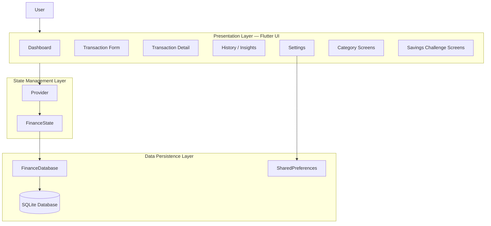
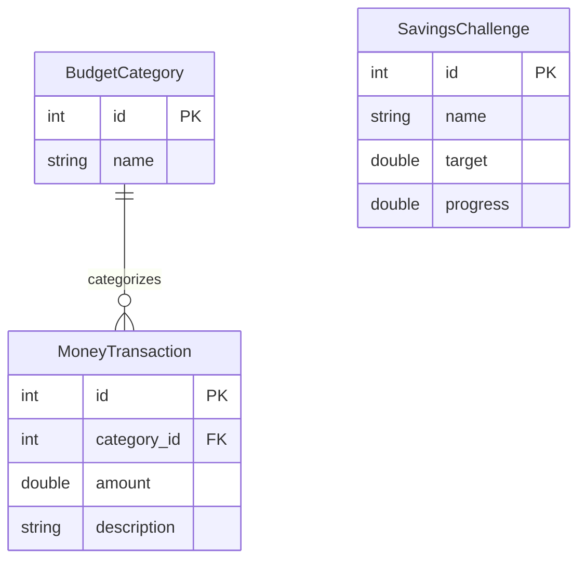
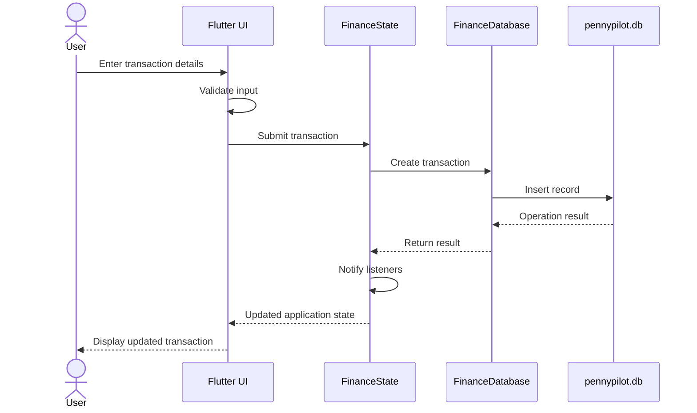

# PennyPilot — System Architecture

## 1. Architecture Overview

PennyPilot follows a layered Flutter application architecture that separates the user interface, application state management, database operations, and local persistence.

The application uses Provider and ChangeNotifier through `FinanceState` to manage application state. Financial data is persisted locally using SQLite through `FinanceDatabase`, while application preferences are stored using SharedPreferences.

### High-Level Architecture



## 2. Architecture Components

### A. Presentation Layer

The presentation layer contains the Flutter screens and widgets responsible for user interaction.

Five primary screen roles:

1. Dashboard
2. Transaction Form
3. Transaction Detail
4. History / Insights
5. Settings

Category and Savings Challenge screens provide additional functionality.

Responsibilities:
- Display financial information.
- Collect and validate user input.
- Present transaction and category information.
- Display savings progress.
- Show financial insights and charts.
- Provide application settings and navigation.

### B. State Management Layer

PennyPilot uses Provider and Flutter's ChangeNotifier through `FinanceState`.

Responsibilities:
- Maintain application state.
- Coordinate database operations.
- Notify listening widgets when data changes.
- Manage financial records and related application information.
- Support UI updates following successful data operations.

### C. Database Layer

`FinanceDatabase` provides SQLite database operations.

The local database is named:

`pennypilot.db`

It manages three primary entities:

- `BudgetCategory`
- `MoneyTransaction`
- `SavingsChallenge`

The database supports local persistence and offline financial management.

## 3. Database Design

### Entity Relationship Diagram



*Note: The diagram illustrates the primary entity relationship. Refer to the implementation for the complete database columns and constraints.*

### A. BudgetCategory

Represents the categories used to organize financial transactions.

Supported operations:
- Create category.
- List categories.
- Edit category.
- Delete category.

### B. MoneyTransaction

Represents individual financial transactions associated with a category.

Supported operations:
- Create transaction.
- List transactions.
- Edit transaction.
- Delete transaction.

### Category–Transaction Relationship

A `BudgetCategory` can have multiple `MoneyTransaction` records.

The relationship is maintained through `category_id`.

**Referential integrity:**

- Deleting a category with linked transactions is blocked.
- An explicit count check identifies linked transactions.
- SQLite foreign key restriction prevents deletion while child transactions remain.
- Users must move or delete the associated transactions before deleting the category.

This prevents accidental loss of category relationships and maintains database consistency.

### C. SavingsChallenge

Represents an individual savings goal.

Supported operations:
- Start a challenge.
- Track progress.
- Finish a challenge.
- Reset progress.
- Delete a challenge.

Savings challenge information is persisted in SQLite.

## 4. Application Data Flow

### Transaction Creation



### Savings Challenge Progress

1. The user opens a savings challenge.
2. The user records or updates progress.
3. `FinanceState` coordinates the operation.
4. `FinanceDatabase` persists the updated information.
5. The application refreshes the relevant UI.

## 5. Local Storage and Persistence

PennyPilot uses two local persistence mechanisms.

| Technology | Responsibility |
|---|---|
| SQLite | Financial categories, transactions, and savings challenges |
| SharedPreferences | Application settings and preferences |

The application is designed to support its core financial workflows offline.

## 6. Settings and Notifications

Application settings are stored using SharedPreferences.

The reminder switch currently stores a user preference only.

**Important:** Operating-system scheduled notifications are not implemented in the current version.

## 7. Testing and Quality Assurance

PennyPilot includes automated unit and widget tests.

Final recorded test results:

| Metric | Result |
|---|---:|
| Tests passed | 152 |
| Tests failed | 0 |
| Line coverage | 80.13% |

Run tests:

```bash
flutter test
```

Generate coverage:

```bash
flutter test --coverage
```

## 8. Additional Implemented Features

The final application also includes:

- CSV transaction export.
- Persistent dark and light themes.
- Advanced filtering and sorting.
- Spending-by-category visualizations.
- Financial insights and forecasting.

These features extend the core budgeting and savings functionality.

## 9. Future Improvements

Potential future enhancements include:

- Scheduled operating-system notifications.
- CSV import.
- Additional automated integration testing.
- Advanced animations.
- Optional encrypted backups and multi-device synchronization.

These are potential improvements and should not be considered implemented features.

---

**Project:** PennyPilot — Offline Budgeting & Savings Companion

**Team Members:**  
Akshitha Sainath Sanagarapu  
Mouni Sri Nallapaneni

**Repository:** https://github.com/MouniSri039/PennyPilot
