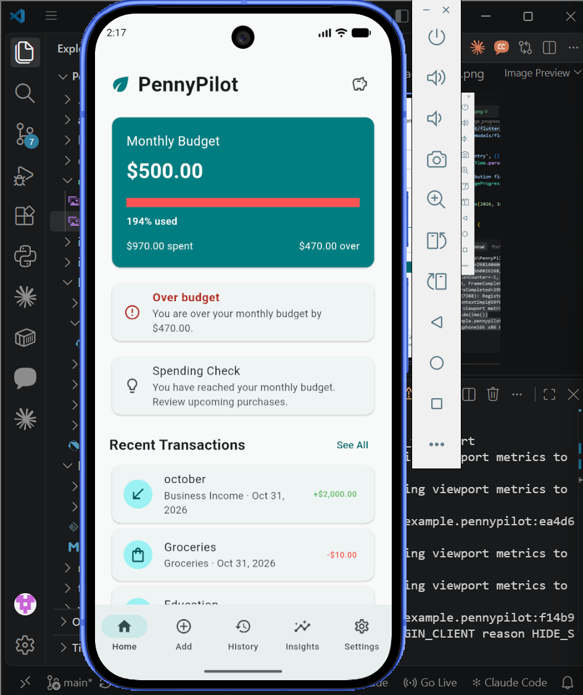
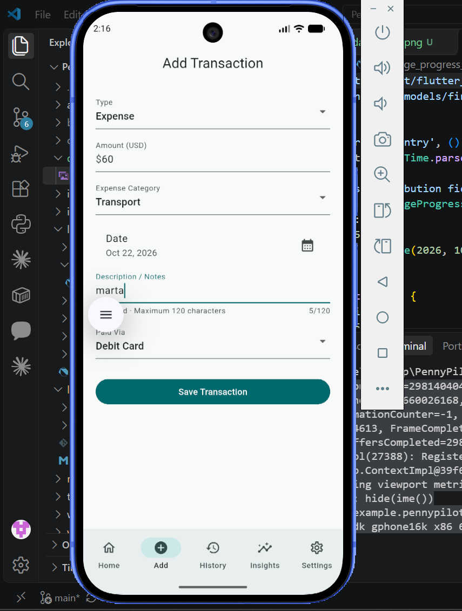
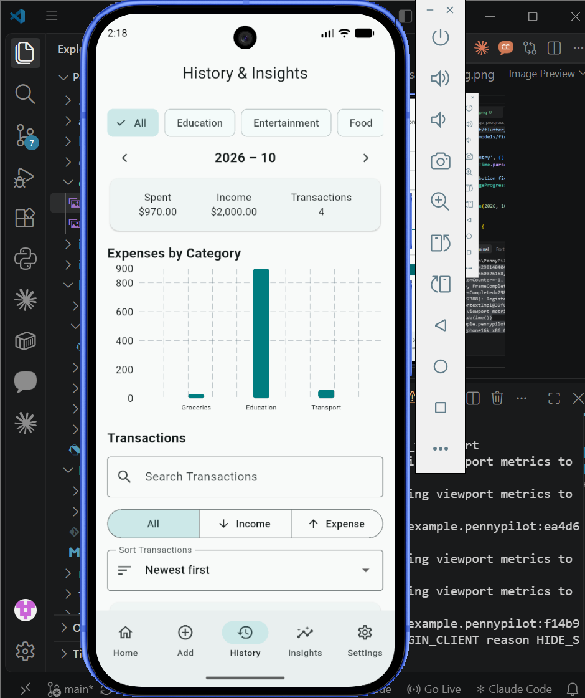
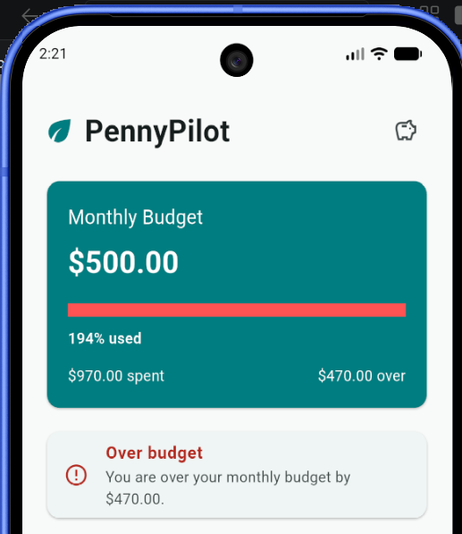
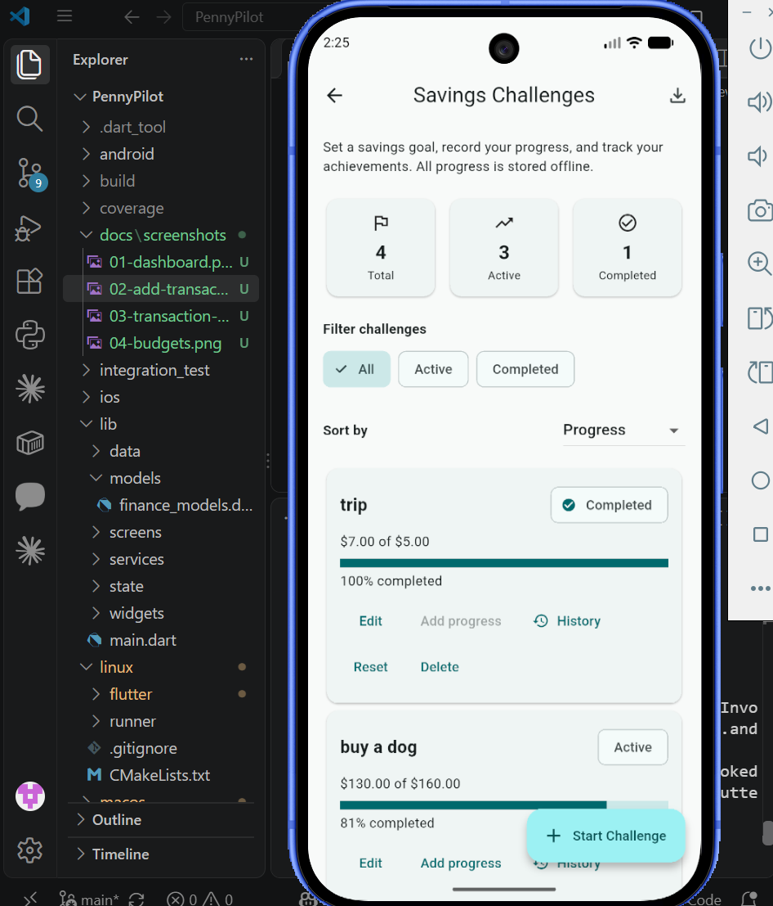
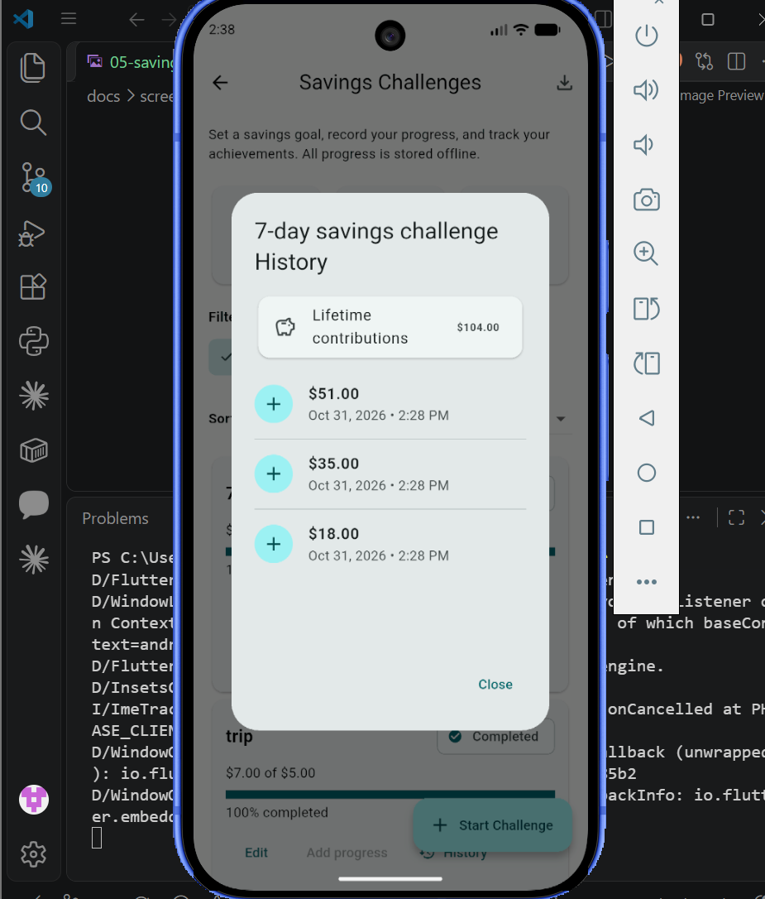
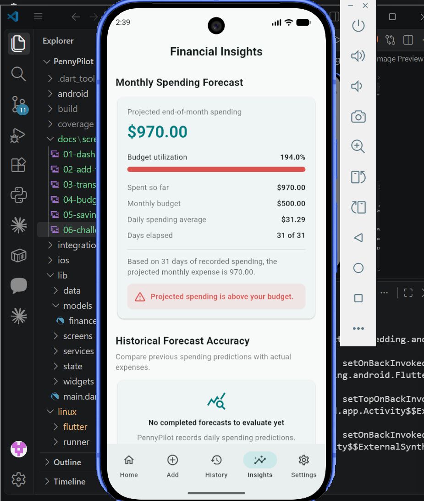
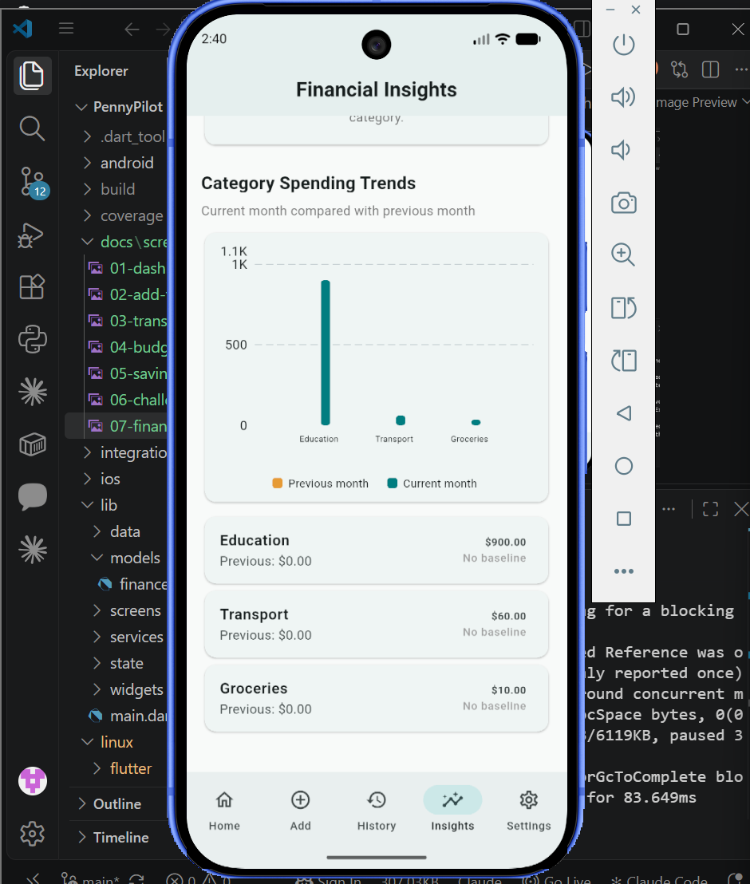
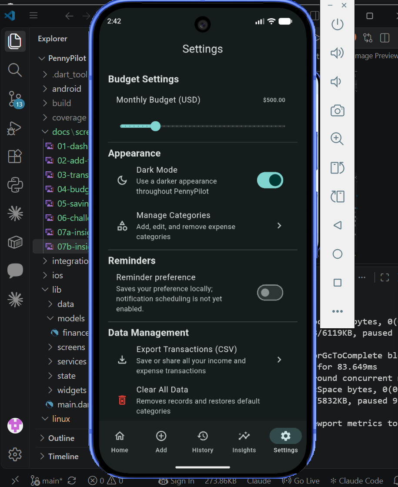

# PennyPilot — Offline Budgeting & Savings Companion

**PennyPilot** is a Flutter-based personal finance application designed to help users manage everyday expenses, monitor monthly budgets, track savings goals, and understand their spending habits.

The application prioritizes offline functionality, local data persistence, and an accessible interface with light and dark themes.

## Team

| Team Member | Role |
|---|---|
| Akshitha Sainath Sanagarapu | Developer |
| Mouni Sri Nallapaneni | Developer |

- **GitHub:** [MouniSri039/PennyPilot](https://github.com/MouniSri039/PennyPilot)
- **ClickUp:** [Team PennyPilot Workspace](https://app.clickup.com/90141780871/v/b/2kydwuw7-354)

---

## Features

### 1. Dashboard and Budget Monitoring
- View monthly financial information.
- Monitor monthly budget limits and spending.
- View budget utilization and over-budget alerts.
- Access recent transactions.

### 2. Transaction Management
- Add, view, edit, and delete transactions.
- Organize transactions using categories.
- Validate transaction forms.
- View transaction history.
- Confirm destructive actions before deletion.

### 3. Savings Challenges
- Create and manage savings challenges.
- Record contributions and track progress.
- View contribution history.
- Monitor completed challenges.
- Maintain savings progress through local persistence.

### 4. Financial Insights
- Explore spending patterns.
- View spending-by-category charts.
- Review financial summaries and spending breakdowns.
- Access available forecasting and analytical insights.

### 5. Advanced Functionality
- Export financial transaction data to CSV.
- Filter and sort financial records.
- Support persistent dark and light themes.
- Store application data locally for offline access.

---

## Technology Stack

| Technology | Purpose |
|---|---|
| Flutter | Cross-platform application development |
| Dart | Application programming language |
| SQLite | Local relational database |
| SharedPreferences | Persistent application settings |
| ChangeNotifier | Application state management |
| Flutter testing framework | Unit and widget testing |

---

## Application Screenshots

Screenshots are available in `docs/screenshots/`.

### Dashboard


### Add Transaction


### Transaction History


### Budgets


### Savings Challenges


### Savings Challenge Progress


### Financial Insights




### Dark Mode


---

## Getting Started

### Prerequisites

Install the following:

- Flutter SDK
- Dart SDK (included with Flutter)
- Android Studio
- Android SDK and an Android emulator or physical device
- Visual Studio Code (recommended)

### Installation

Clone the repository:

```bash
git clone https://github.com/MouniSri039/PennyPilot.git
```

Navigate to the project:

```bash
cd PennyPilot
```

Install dependencies:

```bash
flutter pub get
```

Run the application:

```bash
flutter run
```

### Run Tests

Execute the complete test suite:

```bash
flutter test
```

Generate test coverage:

```bash
flutter test --coverage
```

### Build Android APK

```bash
flutter build apk --release
```

The generated APK is available at:

```text
build/app/outputs/flutter-apk/app-release.apk
```

---

## Architecture

PennyPilot follows a layered Flutter application structure that separates the user interface, application state, database operations, and local persistence.

See [ARCHITECTURE.md](ARCHITECTURE.md) for the architecture diagram, component responsibilities, and data flow.

---

## Testing and Evaluation

The final recorded test run produced:

| Metric | Result |
|---|---:|
| Tests passed | 152 |
| Tests failed | 0 |
| Line coverage | 80.13% |

Test execution:

```bash
flutter test --coverage
```

Coverage is calculated using the generated `coverage/lcov.info` file.

---

## Offline Functionality and Data Persistence

PennyPilot uses local storage to support its core finance-management workflows without requiring a continuously available internet connection.

- Financial records are stored in a local SQLite database.
- Application preferences are persisted locally.
- Savings challenge progress is maintained locally.
- Theme preferences persist across application restarts.

---

## Team Collaboration

Team development and task coordination are managed through GitHub and ClickUp.

The team uses individual branches, meaningful commits, pull requests, and code reviews to organize development.

See `TEAM_COMMITS.md` for the team's contribution and commit workflow.

---

## Future Improvements

Potential improvements include:

- Scheduled local notifications and reminders.
- Additional financial analytics.
- Expanded automated integration testing.
- Optional backup and synchronization capabilities.
- Additional accessibility improvements.

---

## Project

**PennyPilot — Offline Budgeting & Savings Companion**

Developed by Team PennyPilot as a graduate-level software development project.
